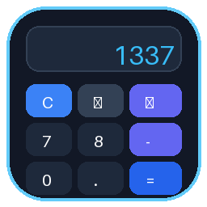
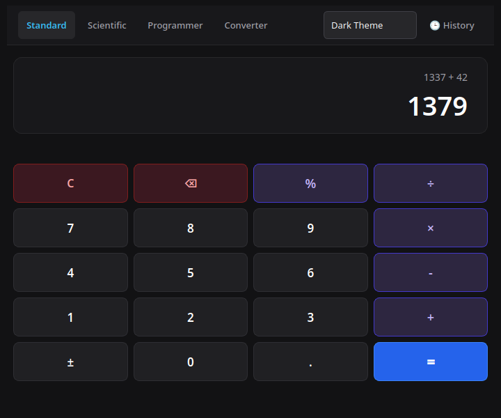
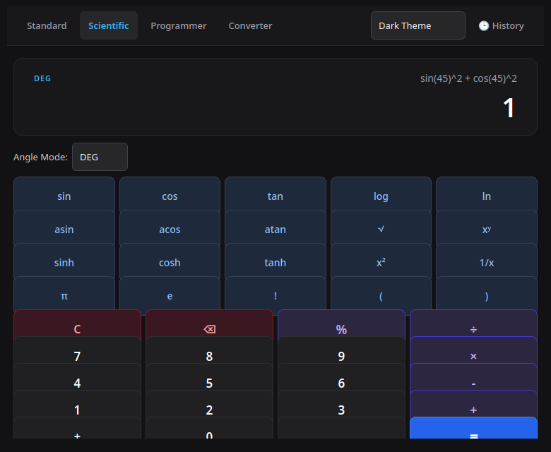
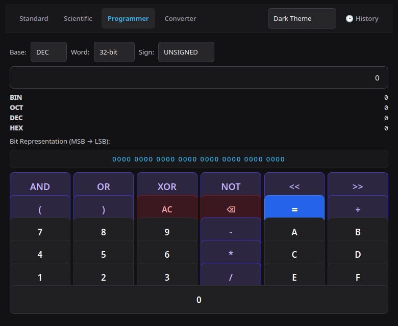
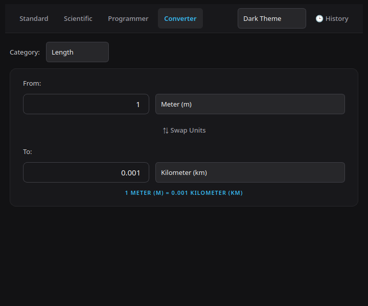

# Kira Calculator

<p align="center">
  
</p>

<p align="center">
  <strong>A secure, cross-platform desktop calculator for everyday, scientific, programmer, and unit-conversion work.</strong>
</p>

<p align="center">
  <a href="https://github.com/livelyfun/kira-calculator/releases/latest">Download</a> ·
  <a href="#features">Features</a> ·
  <a href="#installation">Installation</a> ·
  <a href="#security">Security</a> ·
  <a href="#development">Development</a>
</p>

---

## Download

**Get the latest standalone build from [GitHub Releases](https://github.com/livelyfun/kira-calculator/releases/latest).** Choose the asset matching your operating system. Standalone packages bundle the application and its Python/Qt runtime; a separate Python installation is not required.

| Platform | Download | How to run |
| --- | --- | --- |
| Linux x86_64 | `kira-calculator-<version>-linux-x86_64.tar.gz` | Extract, then run `./bin/kira-calculator` from the extracted folder |
| Windows x64 | `kira-calculator-windows-x64.zip` | Extract, then open `kira-calculator.exe` |
| macOS | `kira-calculator-macos-*.zip` | Extract, then run the included executable |

Release assets and exact filenames are shown on the [Releases page](https://github.com/livelyfun/kira-calculator/releases). Builds are produced on native GitHub-hosted runners. Check the release notes for the platforms included in each version.

### Linux installation

1. Download the Linux `.tar.gz` asset from the latest release.
2. Extract it:
   ```bash
   tar -xzf kira-calculator-*-linux-*.tar.gz
   cd kira-calculator
   ```
3. Launch:
   ```bash
   ./bin/kira-calculator
   ```

The archive also includes the project README and license. To verify an asset, download its matching `.sha256` file and run:
```bash
sha256sum -c kira-calculator-*-linux-*.tar.gz.sha256
```

### Windows installation

1. Download the Windows ZIP asset.
2. Extract it using File Explorer.
3. Double-click `kira-calculator.exe`.

If Windows SmartScreen displays an unknown-publisher warning, review the source and release provenance before choosing whether to run it. The project currently does not claim a signed Windows executable.

### macOS installation

1. Download and extract the macOS ZIP asset.
2. Run the included `kira-calculator` executable from Terminal.

The macOS build is not currently notarized. Gatekeeper may warn when launching an unsigned build. Review the release provenance and source before deciding whether to proceed.

### Build from source

Requires Python 3.10 or newer:
```bash
git clone https://github.com/livelyfun/kira-calculator.git
cd kira-calculator
python -m venv .venv
# Linux/macOS
source .venv/bin/activate
# Windows PowerShell: .venv\Scripts\Activate.ps1
python -m pip install --upgrade pip
python -m pip install -e .
kira-calculator
```

---

## Features

- **Standard calculator:** everyday arithmetic, percentages, sign changes, and parentheses.
- **Scientific calculator:** trigonometric and hyperbolic functions, logarithms, powers, roots, factorials, constants, and DEG/RAD/GRAD angle modes.
- **Programmer calculator:** binary, octal, decimal, and hexadecimal; configurable 8/16/32/64-bit word sizes; signed and unsigned values; bitwise operations.
- **Unit converter:** length, mass, temperature, data, area, speed, time, and volume.
- **Persistent preferences and history:** theme, window state, angle mode, and calculation history are saved locally.
- **Dark and light themes:** switch between themes from the application.

## Screenshots

<p align="center">
  
  
</p>
<p align="center">
  
  
</p>

## Security

Expressions are treated as untrusted input and processed by a custom tokenizer, parser, and constrained AST evaluator. The calculation engine does not use Python `eval()`, `exec()`, or `asteval`. Input length, AST depth, node count, and exponent magnitude are bounded.

See [docs/security_model.md](docs/security_model.md) for the implementation's security assumptions and limits.

## Keyboard shortcuts

| Shortcut | Action |
| --- | --- |
| `0`–`9`, `.` | Enter numbers |
| `+`, `-`, `*`, `/` | Arithmetic |
| `^` | Exponentiation |
| `!` | Factorial |
| `%` | Percentage |
| `Enter` | Calculate |
| `Backspace` | Delete last character |
| `Escape` | Clear |
| `Ctrl+H` | Toggle history |
| `Ctrl+1`–`Ctrl+4` | Switch calculator modes |

## Development

Install development dependencies and run the checks:
```bash
python -m pip install -e ".[dev]"
pytest
ruff check .
ruff format --check .
```

Build a standalone package on the current operating system:
```bash
python -m pip install -e ".[packaging]"
python scripts/build_app.py --onefile
```

Cross-platform release packages are built by [GitHub Actions](.github/workflows/ci.yml) on native Linux, Windows, and macOS runners. Push a version tag such as `v1.0.1` to trigger a GitHub Release after the test and packaging jobs succeed.

## License

Kira Calculator is distributed under the **GNU Affero General Public License v3.0 only (AGPL-3.0-only)**. See [LICENSE](LICENSE).

Third-party dependencies retain their respective licenses.
