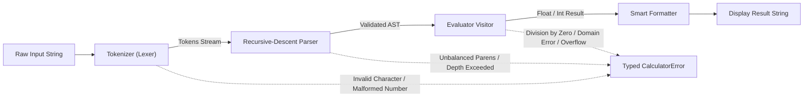

# Kira Calculator: System Architecture & Design

## 1. Overview & Principles

Kira Calculator is a production-grade cross-platform desktop calculator built with Python 3.10+ and PySide6 (Qt6). It is designed around the following architectural principles:

- **Strict Separation of Concerns:** Mathematical computation, data persistence, and graphical presentation are completely decoupled.
- **Zero Insecure Execution:** No arbitrary code execution, `eval()`, `exec()`, or unconstrained `asteval`. All expressions pass through an explicit lexer, recursive-descent parser, AST builder, and allowlisted numerical evaluator.
- **Deterministic Resource Bounding:** Strict execution limits prevent DoS from catastrophic backtracking, deep parenthetical recursion, huge exponents, or unbounded factorials.
- **Atomic Persistence:** Local history and configuration are saved using atomic filesystem replacements to prevent corruption on unexpected termination.
- **Responsive & Accessible Desktop UI:** Qt layout hierarchy adapting smoothly from compact windows to 4K displays.

---

## 2. Package Architecture

```
kira-calculator/
├── src/
│   ├── kira_calculator/
│   │   ├── __init__.py           # Package version and public exports
│   │   ├── __main__.py           # Execution entry point (python -m kira_calculator)
│   │   ├── app.py                # Qt application lifecycle and window creation
│   │   ├── core/                 # Mathematical expression calculation engine
│   │   │   ├── errors.py         # Strongly-typed error hierarchy
│   │   │   ├── ast_nodes.py      # Immutable dataclass AST representations
│   │   │   ├── tokenizer.py      # Lexical analyzer with security length bounds
│   │   │   ├── parser.py         # Recursive descent parser with depth bounds
│   │   │   ├── evaluator.py      # AST visitor interpreting mathematical semantics
│   │   │   ├── formatter.py      # Float normalization & precision formatting
│   │   │   └── engine.py         # Unified calculation facade
│   │   ├── modes/                # Specific calculator mode engines
│   │   │   ├── standard.py       # Standard arithmetic facade
│   │   │   ├── scientific.py     # Scientific angle-mode calculation context
│   │   │   ├── programmer.py     # Multi-base integer & bitwise engine
│   │   │   └── converter.py      # 8-category bidirectional unit converter
│   │   ├── services/             # Application services & persistence
│   │   │   ├── history_service.py# Atomic JSON history persistence
│   │   │   └── settings_service.py # Atomic JSON user preference persistence
│   │   └── ui/                   # PySide6 desktop interface
│   │       ├── main_window.py    # Main application shell & keyboard routing
│   │       ├── pages/            # Standard, Scientific, Programmer, Converter pages
│   │       ├── widgets/          # Display, HistoryDrawer, NavigationBar
│   │       └── themes/           # Dark and Light QSS stylesheets
│   └── main.py                   # Backward-compatible script launcher
├── assets/icons/                 # Application icon (PNG & SVG)
├── packaging/                    # PyInstaller specifications and Linux desktop files
├── tests/                        # Comprehensive unit, security, and UI test suite
└── docs/                         # Engineering documentation
```

---

## 3. Calculation Engine Pipeline



### 1. Tokenizer (`core/tokenizer.py`)
- Enforces `MAX_EXPRESSION_LENGTH = 2000`.
- Identifies numbers (integer, float, scientific notation `1e5`, `2.5e-3`).
- Maps mathematical operators: `+`, `-`, `*`, `×`, `/`, `÷`, `%`, `^`, `!`.
- Maps Greek symbols (`π`, `φ`, `τ`, `√`) to canonical names.
- Recognizes safe allowlisted function identifiers (`sin`, `cos`, `tan`, `log`, `ln`, etc.).
- Rejects unknown identifiers and unauthorized characters.

### 2. Parser (`core/parser.py`)
- Recursive-descent grammar implementation.
- Enforces `MAX_DEPTH = 100` and `MAX_NODES = 1000`.
- Explicit operator precedence:
  1. Additive: `+`, `-`
  2. Multiplicative: `*`, `×`, `/`, `÷`, `%` (modulo), and implicit multiplication
  3. Prefix Unary: `+`, `-`
  4. Exponentiation: `^` (right-associative)
  5. Postfix: `!`, `%` (percentage)
  6. Primary: numbers, constants, parentheses, functions.
- Supports implicit multiplication: `2(3)`, `2pi`, `2sin(30)`, `(2+3)(4+1)`.
- Enforces strict mathematical binding: `-2^2` parses as `-(2^2) = -4`.

### 3. Evaluator (`core/evaluator.py`)
- Pure visitor pattern traversing only validated `ASTNode` subclasses.
- Rejects attribute access, object instantiations, and arbitrary callable execution.
- Angle mode normalization: `DEG`, `RAD`, `GRAD`.
- Domain guards: non-positive log arguments, negative square roots, undefined tangents ($\tan(90^\circ)$).
- Exponent bounds: $|exp| \le 10000$ to prevent computational resource exhaustion.
- Factorial bounds: $n \le 170$ to prevent floating-point infinity and memory DoS.

### 4. Smart Formatter (`core/formatter.py`)
- Suppresses IEEE 754 precision noise (`0.1 + 0.2` formats as `0.3`).
- Displays exact integers without trailing `.0`.
- Formats extreme magnitudes ($\ge 10^{14}$ or $< 10^{-6}$) in clean scientific notation.

